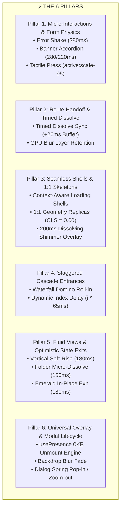

<div align="center">

# ⚡ Synapse Motion Framework

**Fluid, zero-dependency motion design system for React and Tailwind CSS.**  
*Inspired by the rapid, organic signal transmission of biological synapses.*

[](https://opensource.org/licenses/MIT)
[](https://react.dev/)
[](https://tailwindcss.com/)
[](#)
[](#)

</div>

---

## 🌟 Why Synapse Motion?

Modern web applications often suffer from **two extremes**:
1. **Bloated Runtime Libraries**: Heavy animation libraries ($\sim 40\text{--}60$ KB gzipped) that add JavaScript parsing overhead, layout thrashing, and dependency version lockouts.
2. **Naive CSS Transitions**: Choppy route transitions, flickering modals on unmount, jarring layout shifts (CLS), and snap-cut tab changes.

**Synapse Motion Framework** bridges this gap using the **Shadcn UI model** (Copy-Paste Architecture). You own the code. It delivers enterprise-grade physics and zero-flicker transitions using **pure CSS keyframes hardware-acceleration + React timing orchestration with 0 KB runtime overhead**.

---

## 🏛️ The 6 Pillars of Synapse Motion



---

## 🚀 Quickstart (Installation)

Following the **Shadcn UI philosophy**, Synapse Motion is distributed via copy-paste scaffolding so Tailwind CSS can compile the utility classes directly within your project.

### Step 1: Copy Components to Your Project
In your project terminal (React + Vite + Tailwind CSS), run a single command:

```bash
npx degit tsukuyo27/synapse-motion/src src/components/ui/motion
```

### Step 2: Register the Tailwind Preset
Add the Synapse preset into your `tailwind.config.js`:

```javascript
// tailwind.config.js
import synapsePreset from './src/components/ui/motion/config/tailwind.synapse-preset.js';

/** @type {import('tailwindcss').Config} */
export default {
  presets: [synapsePreset],
  content: [
    "./index.html",
    "./src/**/*.{js,ts,jsx,tsx}",
  ],
  theme: {
    extend: {},
  },
  plugins: [],
}
```

---

## 💡 Usage Examples

### 1. Staggered Cascade Lists (`SynapseStagger`)
Create domino-style waterfall card entrances with sequential dynamic delays:

```jsx
import { SynapseStagger } from '@/components/ui/motion';

export function ProjectGrid({ projects }) {
  return (
    <div className="grid grid-cols-1 md:grid-cols-3 gap-4">
      {projects.map((project, index) => (
        <SynapseStagger key={project.id} index={index} delayStep={65} direction="up">
          <ProjectCard data={project} />
        </SynapseStagger>
      ))}
    </div>
  );
}
```

---

### 2. Zero-Dependency Modal with Exit Transitions (`SynapseModal`)
An accessible dialog with backdrop-blur and spring scaling that smoothly animates both on **entrance and exit**:

```jsx
import { useState } from 'react';
import { SynapseModal } from '@/components/ui/motion';

export function SettingsDialog() {
  const [isOpen, setIsOpen] = useState(false);

  return (
    <>
      <button 
        onClick={() => setIsOpen(true)}
        className="px-4 py-2 bg-blue-600 text-white rounded-xl active:scale-95 transition-transform"
      >
        Open Settings
      </button>

      <SynapseModal 
        isOpen={isOpen} 
        onClose={() => setIsOpen(false)} 
        title="Account Preferences"
      >
        <p className="text-slate-600 dark:text-slate-300">
          This modal animates in with pop-in and exits smoothly with zoom-out!
        </p>
      </SynapseModal>
    </>
  );
}
```

---

### 3. Custom Unmount Presence Engine (`usePresence`)
Need to animate your own custom drawer, banner, or popover on exit without `framer-motion`?

```jsx
import { usePresence } from '@/components/ui/motion';

export function CustomDrawer({ isOpen, onClose }) {
  const { shouldRender, isClosing } = usePresence(isOpen, 200);

  if (!shouldRender) return null;

  return (
    <aside className={`fixed right-0 top-0 h-full w-80 bg-white shadow-2xl transition-all ${
      isClosing ? 'animate-fade-out translate-x-full' : 'animate-fade-in translate-x-0'
    }`}>
      <button onClick={onClose}>Close</button>
      <p>Drawer Content</p>
    </aside>
  );
}
```

---

### 4. Zero-Flicker Route Transitions (`useTimedNavigate`)
Eliminates white flashes and mid-flight cutoffs when switching routes:

```jsx
import { useNavigate } from 'react-router-dom';
import { useTimedNavigate } from '@/components/ui/motion';

export function LoginCard() {
  const navigate = useNavigate();
  const { isDissolving, timedNavigate } = useTimedNavigate(navigate, 200, 20);

  const handleLoginSuccess = () => {
    // Fades out the current view smoothly, waits +20ms safety buffer, then navigates
    timedNavigate('/dashboard');
  };

  return (
    <div className={`transition-opacity duration-200 ${isDissolving ? 'opacity-0' : 'opacity-100'}`}>
      <button onClick={handleLoginSuccess}>Sign In</button>
    </div>
  );
}
```

---

### 5. 1:1 Modular Atomic Skeletons
Eliminate Cumulative Layout Shift (CLS) by matching live content geometry 1:1:

```jsx
import { KpiSkeleton, ChartSkeleton, TableSkeleton, CardSkeleton } from '@/components/ui/motion';

export function AnalyticsDashboard({ isLoading, data }) {
  if (isLoading) {
    return (
      <div className="space-y-6">
        <div className="grid grid-cols-1 sm:grid-cols-4 gap-4">
          <KpiSkeleton /><KpiSkeleton /><KpiSkeleton /><KpiSkeleton />
        </div>
        <ChartSkeleton />
        <TableSkeleton rows={4} />
      </div>
    );
  }

  return <ActualDashboardContent data={data} />;
}
```

---

## ⏱️ Mathematical Timing & Invariants

| Token Identifiers | Duration | Easing Curve | Target Visual Scenario |
| :--- | :--- | :--- | :--- |
| `SYNAPSE_PRESS` | 100 ms | `ease-out` | Tactile touch/click response (`active:scale-95`) |
| `SYNAPSE_POP` | 250 ms | `cubic-bezier(0.175, 0.885, 0.32, 1.275)` | Dialog pop-in entrance spring |
| `SYNAPSE_FADE_IN` | 200 ms | `cubic-bezier(0, 0, 0.2, 1)` | Elements entering the viewport |
| `SYNAPSE_FADE_OUT` | 180 ms | `cubic-bezier(0.4, 0, 1, 1)` | Elements unmounting / exiting |
| `SYNAPSE_DISSOLVE` | 200 ms | `cubic-bezier(0.4, 0, 0.2, 1)` | Skeleton to live content morph |
| `SYNAPSE_NAV_BUFFER` | 220 ms | `linear` | Route navigate timeout ($200\text{ms} + 20\text{ms}$) |
| `SYNAPSE_STAGGER_STEP`| 65 ms | `linear` | Incremental delay per child in waterfall |
| `SYNAPSE_SHAKE` | 380 ms | `cubic-bezier(0.36, 0.07, 0.19, 0.97)` | Input error feedback vibration |

---

## 📁 Repository Structure

```text
synapse-motion/
├── LICENSE                         # MIT License
├── package.json                    # Metadata & Peer Dependencies
├── README.md                       # Documentation & Quickstart
└── src/
    ├── index.js                    # Barrel export entry point
    ├── config/
    │   └── tailwind.synapse-preset.js # Tailwind CSS preset (keyframes & tokens)
    ├── hooks/
    │   ├── usePresence.js          # Unmount presence engine (0 KB)
    │   └── useTimedNavigate.js     # Anti-flicker route handoff (+20ms buffer)
    └── components/
        ├── SynapseStagger.jsx      # Cascade waterfall container
        ├── SynapseModal.jsx        # Accessible portal dialog
        ├── SynapseDissolve.jsx     # Soft-rise view switcher
        └── skeletons/              # Atomic 1:1 skeleton primitives
            ├── KpiSkeleton.jsx
            ├── ChartSkeleton.jsx
            ├── TableSkeleton.jsx
            └── CardSkeleton.jsx
```

---

## 🤝 Contributing

Contributions, feedback, and star ratings are warmly welcome!
1. Fork this repository.
2. Create your feature branch (`git checkout -b feat/smooth-motion`).
3. Commit your changes (`git commit -m 'feat: add elastic spring preset'`).
4. Push to the branch (`git push origin feat/smooth-motion`).
5. Open a Pull Request.

---

## 📄 License

Distributed under the **MIT License**. Created with ❤️ by [tsukuyo27](https://github.com/tsukuyo27).
